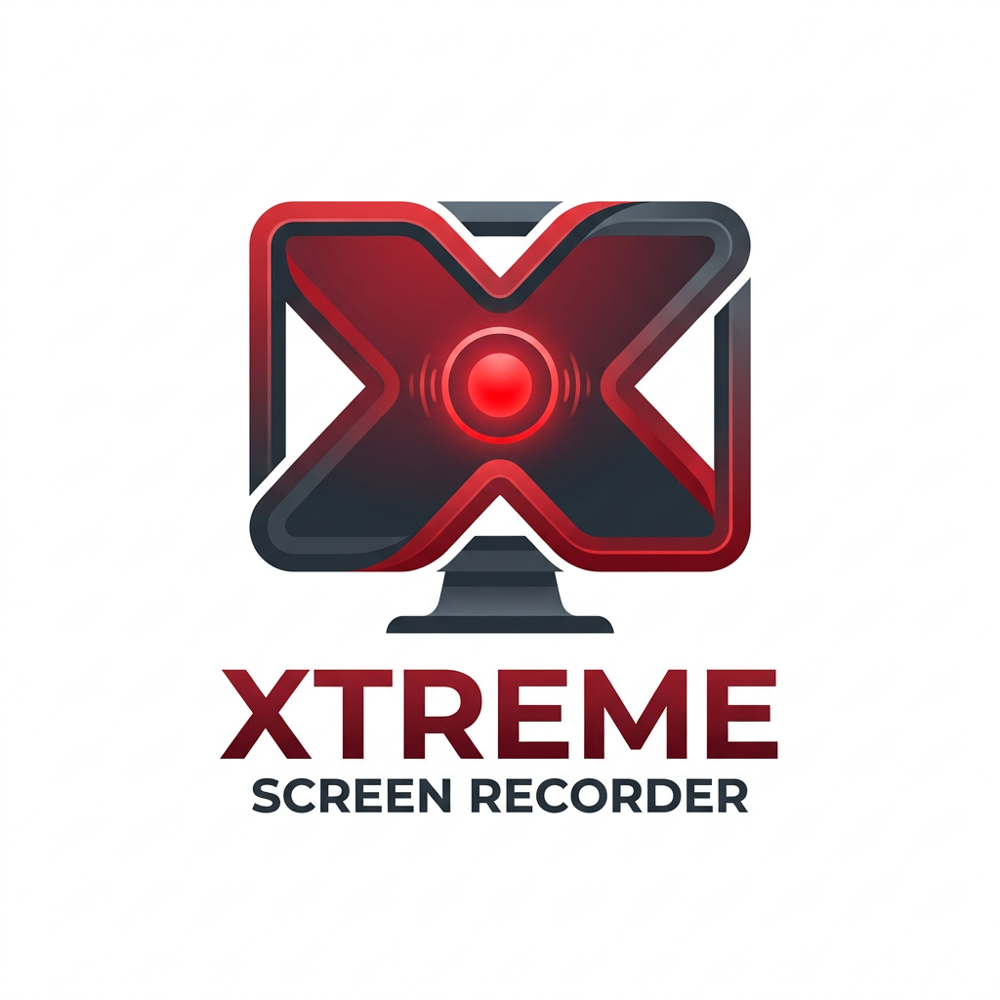

# Xtreme Screen Recorder

**The recording that matters is the one that dies at minute nineteen. This one tries to survive it.**

  

 

## The wall

You record a walkthrough, the browser reloads, and the session is gone. Or you record everything, then spend the evening cropping a 16:9 capture into a vertical clip, muting a notification, and blurring a client name that shouldn't be on screen.

This records the composition you want in the first place, keeps an eye on its own health while running, and converts locally after.

## What changes

**Presets instead of a settings hunt.** High-quality, balanced, compact, presentation, vertical, and GIF-oriented setups, so the format follows the destination.

**Region capture before encoding.** Fixed aspect presets or a custom region, so cropping doesn't become a second job.

**Camera and mix in the recording workspace.** Switch devices, set microphone and system audio levels, no separate mixer window.

**Overlays as part of the capture.** Camera feed in a corner or custom position, mirrored if you prefer. Blur regions, logos, and styled text placed on the composition.

**A monitor while it records.** Actual FPS, dropped frames, A/V sync, segment count, memory, and local storage, visible during the session instead of discovered after.

**Recovery for interrupted sessions.** Where the fragments on disk allow it, a broken session gets salvaged. Finished recordings land in a private local library.

**Conversion on your machine.** Captured media converts to delivery formats locally.

## Who it's for

People recording tutorials, product demos, and bug reports. Anyone who needs vertical clips for social and horizontal cuts for documentation from the same session. Teams where screen recordings leave the machine only when someone chooses to send them.

## Get it

Windows build. Current builds go to supporters directly rather than through a public download button. Process and delivery steps: [SUPPORT.md](SUPPORT.md)

Support the work: [Ko-fi](https://ko-fi.com/pacosalasv) · [PayPal](https://www.paypal.com/paypalme/pacosalas?locale.x=en_US&country.x=MX) (include the product name and your delivery email in the note)

Bugs and requests: [open an issue](https://github.com/pacosalasv/Xtreme_Screen_Recorder-Support/issues)

  

